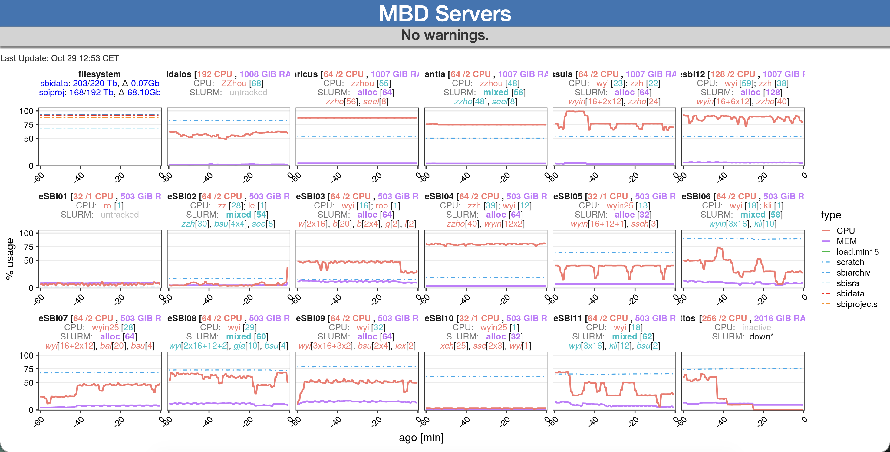

# Glances_Server_Perf

- Visualize server performance measured by Glances using R Shiny

## Example Output



## Usage

### Docker Compose (Recommended)

```bash
# Start RStudio server for interactive editing (port 4040)
# Start Shiny server (port 4444)
docker compose up -d

# Stop services
docker compose down
```

### Make (Legacy)

- **make env**   : starts an RStudio web-server for interactive editing on **port 4040**
- **make shiny** : starts a shiny web-server that listens on **port 4444**


### Access

- **<server>:4444/glances** shows the main SBI working servers
- **<server>:4444/glances_slurm** shows the SLURM servers
- **<server>:4040** RStudio Server (user: rstudio, password: tesseract)


## Notes
- apps must be linked with their directory under **/srv/shiny-servers/**
- welcome.html is used if only the server:port is entered in web-browser


## Thoughts
- to decrease the load on the server, it would be best to compute the image just once in a separate job
  - therefore, the data loading & plot building could be done using a cron job
  - the shiny server would only have a reactiveFileReader on the resulting ggplot
  - this would also make the integration of other information (e.g., max server user) easier


## TODO
- [x] create graphs
- [x] make readable x-axis
- [x] make standalone web-server
- [x] add web-page icon in browser bar
- [x] separate data parsing & figure creation (backend) from web-app (front-end)
- [x] separate core and slurm servers
- [ ] make a switch page between SLURM and non-SLURM servers
- [ ] display a warning if usage of a server is too high
- [x] show top-using user per server
- [x] add overall file system usage
- [x] show scratch usage per server

